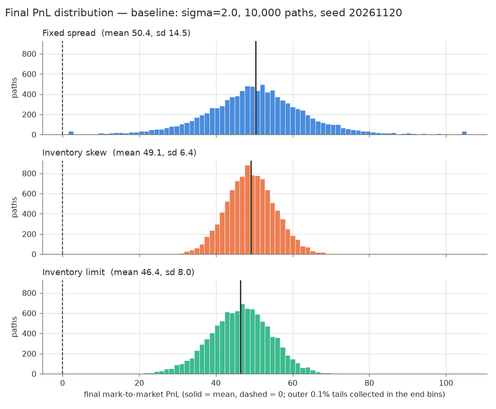
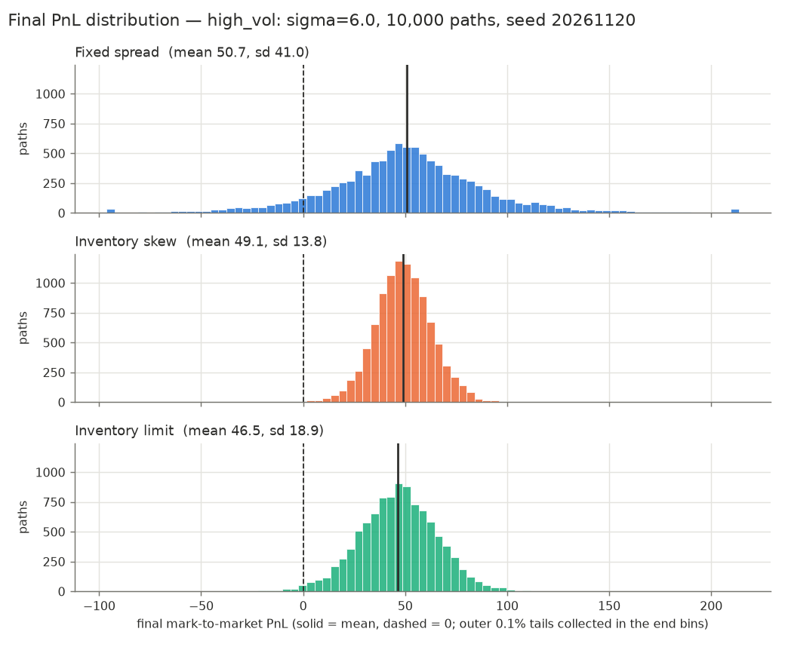
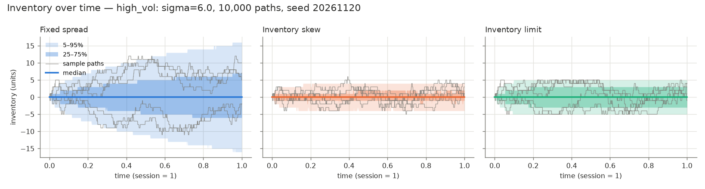
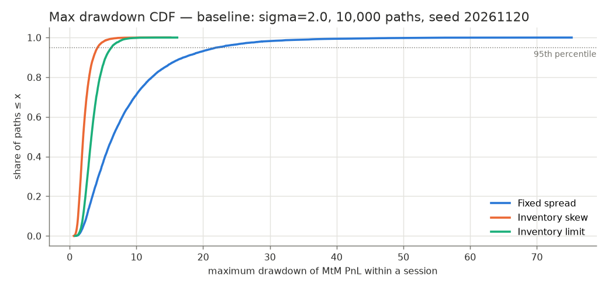
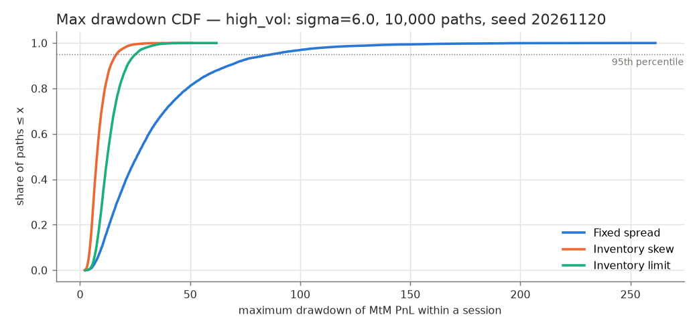
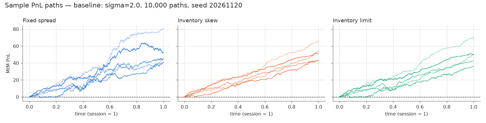
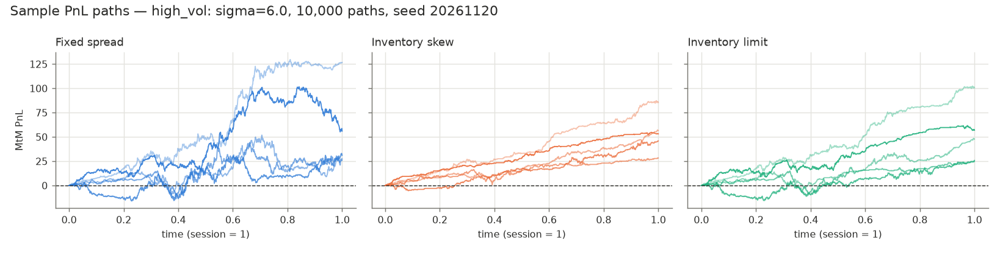

# Two-Sided

**Live app:** https://saketh123456.github.io/two-sided/

A small, fast market-making simulator with a Monte Carlo comparison of three
quoting strategies.

**All data is synthetic.** Mid prices, order arrivals and fills are generated by
the model below. No real market data, quotes or trading records are used or
needed.

## Quick start

```powershell
pip install -r requirements.txt
python -m pytest -q          # 28 tests
python run_analysis.py       # 10,000 paths x 3 strategies x 2 scenarios, about 5 s
python run_analysis.py --paths 2000 --seed 1 --out results_alt   # other settings
```

`run_analysis.py` writes `results/summary.md` (tables), `results/summary.json`
(every number plus the exact parameters) and the PNG plots shown below.

## Web app

`web/` is an interactive front end for the same model, laid out as a single page. It reads
top to bottom:

- **Hero.** It opens with the finding of the current run, written from the results. For example:
  "Inventory skew kept 98% of the fixed spread's profit and cut its risk by 56%." Below it, one
  simulated session plays back in real time: the mid price, the inventory-skew quotes and fills, and
  the inventory of all three strategies on the same orders (`web/js/tape.js`).
- **Parameters.** A deck for the market, strategy and simulation settings.
- **Results.** One scoreboard (return, risk, drawdown, activity, and a paired comparison
  against the fixed spread), followed by the charts.
- **Method.** The three equations behind the model, the λ(δ) curve, and what the model leaves out.

There is no build step. Two web fonts load from Google Fonts: Newsreader for the headline, section
titles, figures and formulas, and Schibsted Grotesk for the interface.

Motion responds to what you do:

- The ladder's bars glide as you drag the inventory.
- When a run finishes, the headline is revealed word by word, the figures count up, histogram bars
  grow from the baseline, and lines draw themselves in.
- Segmented controls get a sliding pill, the chart tabs a sliding underline, and the nav link for
  the section in view is underlined.

All of it turns off when the system asks for reduced motion.

```powershell
cd web
python -m http.server 8765    # then open http://localhost:8765
node --test "tests/*.test.js" # 13 engine tests, including parity with the Python results
```

Browsers block module scripts on `file://` pages, so serve the folder rather than
double-clicking `index.html`.

What it does:

- **Quote ladder** (in Method). Drag the inventory slider to see where each strategy puts its bid and ask.
  Each bar's length is the order arrival rate at that distance, and the limit strategy's
  switched-off side is drawn dashed. In the Method section, the λ(δ) curve marks every live
  quote. Both views call the engine's own `quoteOffsets` and `arrivalRate`, so they show exactly
  what the simulation does.
- **Monte Carlo in a Web Worker.** `js/engine.js` is a port of `mmsim/model.py`. All three
  strategies run in one pass over a single seeded random stream (xoshiro128**), so they see
  identical prices and order arrivals. 10,000 paths × 1,000 steps × 3 strategies take about
  1–2 s on a laptop. Runs can be cancelled, and a new run supersedes an old one.
- **Results.**
  - A scoreboard with each strategy's mean profit, its spread and a profit-distribution
    sparkline, and grouped metrics where the best value in each row is marked.
  - A closed-form check: expected spread income against the simulated 95% interval.
  - Charts with hover tooltips: profit histograms, inventory percentile bands over time, and
    drawdown distributions.
  - The hero headline is rewritten after every run, so it always states that run's numbers.
- **Sharing and export.** Settings live in the URL hash, so a copied link reopens the exact
  setup. You can download the results as JSON or CSV.
- **Quality.** Light and dark themes (system default, saved per browser), keyboard-navigable
  tabs, Ctrl+Enter to run, inline validation, and layouts tested at 375 px and 1440 px.

**Browser numbers differ slightly from the Python tables.** The browser uses a different
random number generator from NumPy, so individual paths differ. The distributions are the same:
`web/tests/engine.test.js` reruns both scenarios at 10,000 paths and requires every strategy's
mean to match `results/summary.json` within 4 combined standard errors, its standard deviation
within 5%, and its fill count within 1.

## Layout

| Path | Contents |
|---|---|
| `mmsim/model.py` | Market parameters, fill model, vectorised simulator |
| `mmsim/strategies.py` | Fixed spread, inventory skew, inventory limit |
| `mmsim/metrics.py` | Mean / CI / loss probability / drawdown / Sharpe-like summaries |
| `mmsim/plots.py` | Matplotlib figures |
| `run_analysis.py` | Runs the scenarios and writes `results/` |
| `tests/` | pytest suite (model, strategies, metrics) |
| `web/index.html`, `web/css/` | Web app shell and styles (design tokens, light and dark) |
| `web/js/rng.js`, `engine.js`, `metrics.js` | Seeded RNG, simulation engine, summary statistics |
| `web/js/worker.js` | Runs the engine off the main thread |
| `web/js/tape.js` | The live session in the hero (canvas) |
| `web/js/ladder.js`, `charts.js`, `svg.js` | Quote ladder, result charts, SVG helpers |
| `web/js/app.js` | Form state, URL hash, worker lifecycle, results, export, theme |
| `web/tests/` | Node test suite for the engine |

## Model

Each session lasts `T = 1` time unit, split into `N = 1000` steps (`dt = 0.001`).
Each step runs in this order:

1. The strategy sets a bid `S_t - δ_b` and an ask `S_t + δ_a` from the current mid `S_t` and inventory `q_t`.
2. Market orders arrive. The bid fills with probability `1 - exp(-λ(δ_b) dt)`, and the ask independently with `1 - exp(-λ(δ_a) dt)`. Each fill is one unit.
3. Cash and inventory update at the quoted prices.
4. The mid moves: `S_{t+1} = S_t + σ √dt · Z` with `Z ~ N(0,1)` (`price_model="gaussian"`), or `± σ √dt` (`price_model="binary"`).
5. Mark-to-market PnL is `cash + q · S_{t+1}`, tracked at every step.

Default parameters (`MarketParams`):

| Parameter | Value | Meaning |
|---|---|---|
| `s0` | 100 | starting mid |
| `sigma` | 2.0 (baseline), 6.0 (high_vol) | mid volatility in price units per √(session) |
| `A` | 140 | order arrival rate per side for a quote at the mid (per session) |
| `k` | 2.0 | how fast the arrival rate decays with quote distance |
| `n_steps` | 1000 | steps per session |

Strategy defaults: half-spread `h = 0.5` for all three. The skew strategy uses `skew = 0.05`
price units per unit of inventory. The limit strategy uses `max_inventory = 5`.

### Strategies

1. **Fixed spread**: `bid = S - h`, `ask = S + h`, always quoting both sides.
2. **Inventory skew**: centres the quotes on a reservation price `r = S - c·q`, so `bid = r - h` and `ask = r + h`. When long, both quotes drop. The bid fills less often and the ask more often, which pulls inventory back toward zero.
3. **Inventory limit**: same quotes as the fixed spread, but stops quoting the bid when `q ≥ Q_max` and the ask when `q ≤ -Q_max`. Inventory can never leave `[-Q_max, Q_max]` (tested).

## The math

**Fill probability.** Market orders that would hit our quote arrive as a Poisson
process with intensity

    λ(δ) = A · e^(-k δ)

where δ is the quote's distance from the mid. Quotes at or through the mid get the maximum
rate `A`. The chance of at least one arrival in a step is

    P(fill in dt) = 1 - e^(-λ(δ) dt) ≈ λ(δ) dt.

With the defaults, `λ(0.5) = 51.50` per session and `P = 0.0502` per step.

**Expected profit per trade.** Every fill at distance δ earns δ relative to the mid at
the moment of the trade. For a symmetric quote, the expected spread income per session is

    E[spread PnL] = 2 · N · P(fill) · δ = 2 · 1000 · 0.0502 · 0.5 = 50.20.

The simulator agrees. With σ = 0 the PnL equals `h × fills` exactly (tested). With σ = 2 the
fixed-spread mean is 50.42 with a 95% CI of [50.13, 50.70], which contains 50.20. In continuous
time, spread income per side is `δ · A e^(-kδ)`, which is largest at `δ* = 1/k = 0.5`. That is why
0.5 is the default half-spread.

**Why inventory risk matters.** Split the PnL change over one step:

    dPnL = (spread captured on fills) + q_t · dS_t

The second term has mean zero in this model, because the mid has no drift and order flow
ignores future prices. Its variance is

    Var(∫ q dS) = σ² · ∫ E[q_t²] dt.

So inventory **adds risk without adding expected return**. That risk grows with σ² and with
how far inventory wanders. Under a fixed spread, inventory is a random walk: its variance grows
roughly linearly in time and nothing pulls it back. Skew and limits bound `E[q²]`, which cuts
PnL variance in exchange for a little spread income.

In real markets the second term is usually **negative** on average: informed traders hit the
quote just before the price moves against you (adverse selection). This model leaves that out,
so it is the friendliest possible setting for the fixed spread.

## Results

Settings: 10,000 paths per strategy per scenario, seed `20261120`, and common random numbers.
Each strategy sees the same mid-price paths and the same order-arrival draws, so the
differences are paired. Every number below was produced by `python run_analysis.py`
and is copied from `results/summary.md`.

Column definitions:
- **95% CI of mean**: normal-approximation confidence interval for the mean final PnL.
- **5% quantile**: the 5th-percentile final PnL. **ES 5%** is the average of the worst 5% of paths.
- **Sharpe (mean/std)**: mean ÷ standard deviation of final PnL across paths.
- **Median per-path Sharpe**: for each path, the mean per-step PnL change ÷ its standard deviation × √N. The median across paths is reported.
- **Max DD**: the largest peak-to-trough fall of mark-to-market PnL within a session.

### Baseline (σ = 2)

| Strategy | Mean PnL | Std PnL | 95% CI of mean | P(loss) | 5% quantile | ES 5% | Sharpe (mean/std) | Median per-path Sharpe | Max DD median | Max DD 95th | Fills / session | Mean abs inventory |
|---|---|---|---|---|---|---|---|---|---|---|---|---|
| fixed_spread | 50.42 | 14.46 | [50.13, 50.70] | 0.25% | 27.46 | 18.23 | 3.49 | 4.37 | 6.47 | 22.07 | 100.6 | 5.14 |
| inventory_skew | 49.07 | 6.38 | [48.95, 49.20] | 0.00% | 38.76 | 36.13 | 7.70 | 7.71 | 2.03 | 4.19 | 102.7 | 1.68 |
| inventory_limit | 46.38 | 7.97 | [46.23, 46.54] | 0.00% | 32.96 | 29.22 | 5.82 | 6.16 | 3.26 | 6.25 | 92.7 | 2.56 |

Paired difference in mean PnL vs fixed spread: skew **-1.35** [-1.58, -1.11]; limit **-4.03** [-4.24, -3.83].

### High volatility (σ = 6)

| Strategy | Mean PnL | Std PnL | 95% CI of mean | P(loss) | 5% quantile | ES 5% | Sharpe (mean/std) | Median per-path Sharpe | Max DD median | Max DD 95th | Fills / session | Mean abs inventory |
|---|---|---|---|---|---|---|---|---|---|---|---|---|
| fixed_spread | 50.69 | 41.04 | [49.89, 51.50] | 8.42% | -13.87 | -43.15 | 1.24 | 1.69 | 25.80 | 86.89 | 100.6 | 5.14 |
| inventory_skew | 49.15 | 13.77 | [48.88, 49.42] | 0.03% | 26.91 | 20.23 | 3.57 | 3.72 | 7.65 | 16.49 | 102.7 | 1.68 |
| inventory_limit | 46.46 | 18.90 | [46.09, 46.83] | 0.98% | 15.24 | 6.02 | 2.46 | 2.57 | 12.44 | 25.19 | 92.7 | 2.56 |

Paired difference in mean PnL vs fixed spread: skew **-1.55** [-2.25, -0.84]; limit **-4.23** [-4.82, -3.64].

Fill counts and inventory columns are identical across the two scenarios. That is expected: fills
depend only on quote distance from the mid, and these strategies' quote distances don't depend on σ.

### What the numbers show

- **Mean PnL barely changes with volatility** (fixed spread: 50.42 → 50.69). With no adverse
  selection, the inventory term `q·dS` has mean zero, so σ only adds noise.
- **Risk scales with σ under a fixed spread.** Tripling σ roughly triples the PnL standard
  deviation (14.46 → 41.04). The loss probability goes from 0.25% to 8.42%, and the 95th-percentile
  drawdown from 22.07 to 86.89.
- **Inventory skew gives the best risk-adjusted result in both scenarios.** It gives up 1.35–1.55
  of mean PnL, but the standard deviation falls by 56% (σ = 2) and 66% (σ = 6), and the
  95th-percentile drawdown is 4.19 / 16.49 versus 22.07 / 86.89. It also fills slightly *more*
  often (102.7 vs 100.6), because `e^(-kδ)` is convex: the side moved closer gains more fills than
  the side moved away loses.
- **The inventory limit sits in between.** It gives up more spread income (-4.03 / -4.23)
  because it simply stops quoting one side, which lowers fills to 92.7. Its risk reduction is
  smaller than the skew's.
- **Risk control matters more as volatility rises.** The skew strategy's Sharpe advantage over the
  fixed spread grows from 2.2× (7.70 vs 3.49) to 2.9× (3.57 vs 1.24).
- By **mean PnL alone**, the fixed spread is highest in both scenarios. These are single parameter
  choices (`skew = 0.05`, `Q_max = 5`), not tuned optima, so the rankings may change with other values.

### Plots

Final PnL distributions:




Inventory over time (bands are cross-path percentiles; grey lines are individual paths):




Maximum drawdown distributions:




Sample PnL paths (the same five price paths for every strategy):




## Assumptions and what they mean

| Assumption | Effect |
|---|---|
| Order flow independent of future prices (no adverse selection) | Biggest simplification. Real fills cluster before adverse moves, so real profits are lower and inventory is more costly. |
| Arrival rate `A e^(-kδ)`, the same on both sides | Symmetric, stationary flow. No intraday seasonality or order-flow imbalance. |
| At most one fill per side per step, unit size | `P = 1 - e^(-λ dt)` caps each step at one fill per side. Fine when `λ dt` is small (0.05 here). |
| Mid is a driftless random walk (Gaussian or ±1 steps) | Thin tails and constant volatility. No jumps or volatility clustering. |
| Final PnL is marked at the mid | No cost to close out leftover inventory. A fixed spread usually ends with more inventory, so this flatters it. |
| No fees, rebates, latency or queue position | Fills happen exactly at the quoted price whenever an arrival occurs. |
| Quotes through the mid get rate `A` | Arrival rate is capped. Under the default skew, quotes only reach the mid when \|q\| ≥ 10. |

## Tests

`python -m pytest -q` runs 28 tests, including:

- With σ = 0 and symmetric flow, PnL equals `h × fills` exactly and is positive. Its mean matches the
  closed form `2N·P·h` within 4 standard errors, and inventory is mean-zero at every step.
- The same seed reproduces every array bit for bit. Different seeds differ.
- Different strategies run with the same seed see identical price paths (common random numbers).
- Accounting checks: `q = bid fills - ask fills` and `PnL = cash + q·S`.
- The Gaussian mid has the configured σ. The binary mid stays on its lattice.
- Inventory limits are never breached. Skew with `c = 0` and an unreachable limit both reproduce the fixed spread exactly.
- Skew and limits reduce inventory and PnL dispersion versus the fixed spread.
- The streaming drawdown inside the simulator matches a full-path recomputation.
